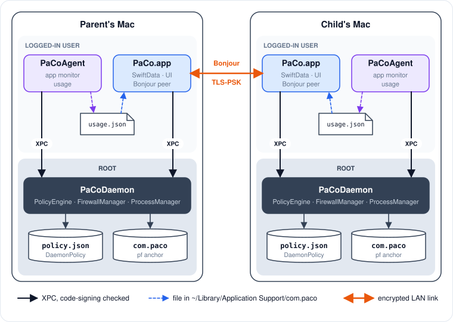

# Architecture

## Components

| Target | Runs as | Lifetime | Owns |
|---|---|---|---|
| **PaCo** (`PaCo/`) | Logged-in user, menu bar app (`LSUIElement`) | While open | SwiftData store, UI for both roles, Bonjour peer, PIN gate |
| **PaCoDaemon** (`PaCoDaemon/`) | root, LaunchDaemon `com.paco.daemon` | Always (`KeepAlive`) | The enforcement policy, schedule evaluation, `pf` anchor, killing processes |
| **PaCoAgent** (`PaCoAgent/`) | Each logged-in user, LaunchAgent `com.paco.agent` | Per GUI session (`KeepAlive`) | Watching running apps, usage counters |
| **PaCoShared** (`PaCoShared/`) | Library | — | Models, `ScheduleEvaluator`, `DaemonPolicy`, wire types, crypto, Keychain |

## Process diagram

<figure><figcaption>
Processes, privilege zones and channels on both Macs.
</figcaption></figure>

## Responsibilities in one line each

* **The daemon decides.** It holds the only copy of the policy, root-owned on disk, and computes "internet on or off" itself every 30 seconds. Nothing in a user's home directory affects enforcement.
* **The agent reports.** It reads the policy back over XPC to know which apps to watch, asks the daemon to kill restricted ones, and writes a usage snapshot.
* **The app configures.** On a parent, it turns SwiftData into a `PolicyTransfer` and pushes it to the local daemon and to every connected child. On a child, it relays the parent's policy, approvals and PIN checks to and from the local daemon.

## Roles

A Mac's role is chosen at onboarding and stored in SwiftData as `DeviceConfig.role`.

| | Parent | Child |
|---|---|---|
| UI | PIN-gated dashboard | Child view; dashboard via online PIN check |
| SwiftData policy | Source of truth | Empty, never published |
| Bonjour | Browses, connects to paired children (TLS client) | Advertises; TLS-PSK listener once paired |
| Local daemon receives policy from | Its own SwiftData | The parent, via the app |

`AppState.role` is the persisted role and drives networking. `AppState.mode` is what the UI shows; on a child it flips to `.parent` only while the dashboard is unlocked. See [App internals](app-internals.md).

## Design principles

* **Enforcement does not depend on the UI.** The daemon reconciles its persisted state at boot and evaluates on its own timer. Closing the app changes nothing.
* **Least trust toward the monitored user.** Policy is root-owned, the daemon only talks to binaries signed by the same team, the PIN hash never reaches a child, and an unpaired child accepts no connections.
* **One message carries the whole policy.** Schedules and restrictions travel together so an app rule never arrives before the schedule it references.
* **Logic that matters lives in PaCoShared** so it can be unit-tested without AppKit, launchd or the network.
