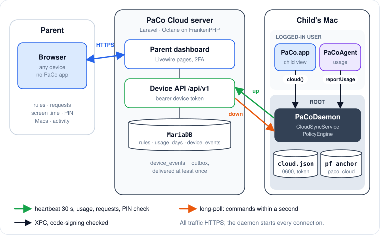

# PaCo Cloud server

PaCo Cloud lets a parent without a second Mac manage a child's Mac from a browser and see its screen time. It is a fourth [communication channel](communication.md#4-daemon-to-paco-cloud-https): the child's **root daemon** talks HTTPS to a Laravel application in `server/`. The Bonjour channel is untouched; a child Mac is managed by a parent Mac **or** by PaCo Cloud (`DeviceConfig.controller`), never both.

<figure><figcaption><p>PaCo Cloud: browser, server, child’s Mac.</p></figcaption></figure>

## Why the daemon is the client

* It is always running (launchd `KeepAlive`), unlike the menu bar app, which is not a login item.
* It already owns the policy, so cloud commands become `PolicyEngine` calls with no new trust path.
* It can keep the device token where the monitored user cannot read it: `/Library/Application Support/PaCo/cloud.json`, mode 0600, written with `SecureFile` (created with the final mode, then renamed).

The app never talks to the server. It asks the daemon through one XPC method, `cloud(_:reply:)`, whose payload is a `CloudXPCRequest` (`enroll`, `unenroll`, `status`, `submitExtensionRequest`, `withdrawRequest`, `verifyPIN`). The agent hands its usage snapshot to the daemon with `reportUsage(_:reply:)` every 30 seconds.

## Code map

| Part | Where |
|---|---|
| Wire types, codec (ISO-8601 dates), event model | `PaCoShared/Sources/PaCoShared/Cloud/` |
| Event reducer, usage outbox, credentials, server URL validation | same folder; unit-tested in `PaCoTests/Cloud*Tests.swift`, `UsageOutboxTests.swift` |
| Daemon client: long-poll, heartbeat, usage upload, relay, token rotation | `PaCoDaemon/CloudSyncService.swift` |
| `pf` relay table | `FirewallRuleBuilder.blockInternetRules(relay:)`, `FirewallManager.updateRelay(_:)` |
| Child UI | `CloudEnrollView`, `ChildModeView`, `RoleSelectionView`, `SettingsView` |
| Server | `server/` (Laravel 12, Livewire, Octane on FrankenPHP); see `server/README.md` |

## Device API

All under `/api/v1`, JSON, dates ISO-8601 without fractional seconds, UUIDs lower case, optional fields as explicit `null`. Every route except `enroll` needs `Authorization: Bearer <device token>`.

| Endpoint | Body → reply |
|---|---|
| `POST /enroll` | `CloudEnrollRequest` → `CloudEnrollResponse` (device id, token, policy version, event cursor). One-time 8-character Crockford code, 15 minutes, single use; `410` when invalid. |
| `GET /device/policy` | → `CloudPolicyEnvelope`: `version`, `activeProfileId`, `manualOverride` (informational), `policy` = a `PolicyTransfer`. `ETag: "v<version>"`; `304` on `If-None-Match`. |
| `POST /device/heartbeat` | `CloudHeartbeatRequest` (what is enforced right now) → `policyStale`, `pendingEvents`. Every 30 s. |
| `POST /device/usage` | `CloudUsageUpload`: time zone plus up to 7 `UsageTransfer` days; stored per device per **child-local** date. |
| `POST /device/extension-requests` | `ExtensionRequestPayload`; idempotent on `requestId`; attributed to the authenticated device. `DELETE …/{id}` withdraws. |
| `GET /device/events?cursor=N&wait=25` | Long-poll, see below. `POST /device/events/ack` acknowledges without polling. |
| `POST /device/pin/verify` | `PINVerifyRequest` → `PINVerifyResult` and nothing else. |
| `POST /device/token/rotate` | → new token; the old one works until the new one is first used. |
| `POST /device/unenroll` | The Mac disconnects itself. |

A refused token gets `401` with `{"error":"invalid_token"}` or `{"error":"device_revoked"}`. On `device_revoked` the daemon forgets its enrollment.

The policy part of the contract is pinned from both sides by one file, `server/tests/Fixtures/policy.json`: the server's `PolicyTest` checks the composer produces it byte for byte, and `CloudFixtureTests` decodes it into the expected `PolicyTransfer`. CI runs the Xcode job when that file changes.

## Events and the long-poll

Parent actions become rows in `device_events`, the outbox. The daemon holds `GET /device/events` open for up to 25 seconds; it returns as soon as there are events with an id above the cursor. The cursor the daemon sends is the id of the last event it applied, which also acknowledges everything up to it.

| Event | Payload | Daemon action |
|---|---|---|
| `policyChanged` | `version` | Fetch the policy if newer than the one applied |
| `activeProfileChanged` | `profileId` | `setActiveProfile`, then fetch |
| `approveExtension` | `requestId`, `grantedMinutes`, `grantedUntil` | Resolve the request; `grantOverride` until `grantedUntil` if still in the future |
| `denyExtension` | `requestId` | Resolve the request |
| `setManualInternet` | `enabled`, `minutes`, `until` | `setManual(enabled:until:)` if `until` is in the future |
| `clearManualInternet` | — | `clearManual` |
| `unenrolled` | — | Forget the enrollment, keep enforcing |

Delivery is at least once, so every time window is absolute: a re-delivered “60 minutes” must not extend the window. `CloudEventReducer` skips ids at or below the cursor and stale policy versions. Unknown types are skipped but acknowledged, so an older daemon keeps working with a newer server.

The heartbeat is the safety net: it reports the policy version the Mac holds, and the server answers `policyStale` when that is behind.

Inserts into the outbox lock the device row first (`DeviceEventOutbox`). InnoDB hands out auto-increment ids at insert time, before commit, so without the lock event 11 could commit before event 10, and a poller already past 11 would never see 10. `tests/MariaDb/OutboxLockTest.php` proves a second writer waits.

### Waiting

Each held poll pins a PHP worker, so the server runs under **Octane with FrankenPHP**, not PHP-FPM, with workers at least the number of devices plus headroom. Between checks a poll either sleeps one second (`PACO_LONGPOLL_WAITER=polling`, the default) or blocks on a per-device Redis list the outbox pushes to after commit (`redis`), which wakes it immediately. Past `PACO_LONGPOLL_MAX_CONCURRENT` held polls, the server answers at once with `retryAfter`.

## Staying reachable while blocked

The block rule drops everything outside private ranges, which would cut the child off from the server exactly when it needs more time. A cloud-enrolled Mac's anchor therefore has a table and one more pass rule, before the block:

```
table <paco_cloud> persist { 203.0.113.7 2001:db8::7 }
pass out quick proto tcp to <paco_cloud> port 443
```

The daemon resolves the server's host every 10 minutes and keeps the last known addresses when resolution fails. It replaces the table in place (`pfctl -a com.paco -t paco_cloud -T replace …`) and never re-applies the whole block, whose `pfctl -F states` would drop the open long-poll. `CloudRelay.validAddresses` lets only literal IP addresses into the rules. See [Firewall](firewall.md#paco-cloud-relay).

DNS itself is not passed. Home routers usually resolve DNS on a private address, which passes; a Mac configured with a public resolver depends on the cached addresses while blocked.

## Server side

* **Data:** `profiles`, `schedules`, `app_restrictions` (server-generated UUIDs, never re-issued, so `allowedScheduleId` stays valid), `child_devices`, `enrollment_codes`, `parent_pins`, `extension_requests`, `usage_days` (one row per device and child-local date), `device_events`.
* **Policy versioning:** model observers on schedules, app rules and profiles call `PolicyPublisher`, which bumps `policy_version` on the parent's devices and queues `policyChanged`. `PolicyPublisher::deferred()` collapses several changes into one.
* **PIN:** Argon2id hash in `parent_pins`, never in any reply. `PinVerifier` mirrors `PINManager`: the fifth consecutive failure locks for 300 seconds.
* **Tokens:** `pcd_<device uuid>.<secret>`, only SHA-256 of the secret stored. The daemon rotates it every 30 days; until the new one is used, both work, so a lost reply cannot lock the Mac out.
* **Parent accounts:** email verification required; optional TOTP two-factor authentication (Fortify actions, Volt pages); password confirmation before removing a Mac or changing the PIN.
* **Notifications:** new requests are mailed, and pushed to browsers the parent subscribed (Web Push, VAPID keys).
* **Database:** MariaDB 10.6 or newer in production (the Docker stack bundles 11.4, or points at an existing server), SQLite for development and the default test run. Three MariaDB details matter: columns that are never null are `datetime`, not `timestamp`, because before 10.10 the first NOT NULL `timestamp` of a table silently gets `ON UPDATE CURRENT_TIMESTAMP`; the connection pins the session time zone to UTC, since `timestamp` values pass through it; and it runs at READ COMMITTED, the isolation the outbox and the long-poll were written for. `tests/MariaDb/SchemaTest.php` guards all three.
* **Scheduler:** `paco:expire-requests` (requests unanswered for 24 hours are denied) and `paco:prune` (old codes, acknowledged events after 90 days, usage after 400 days).

## Developing against a local server

```bash
make server-install server-serve          # SQLite, http://localhost:8080
make server-enroll-code                    # one-time code for parent@example.com
cd server && php artisan paco:push-event "<Mac name>" setManualInternet '{"enabled":false,"minutes":10}'
cd server && php artisan paco:approve      # newest pending request
```

The seeded parent is `parent@example.com` / `password` with PIN `123456`. A **Debug** daemon accepts a plain `http://` address on a loopback host, so type `http://localhost:8080` in the enrollment form; Release builds accept only `https://`. Full daemon testing still needs Developer ID signing, see [Getting started](getting-started.md).

`make server-up` runs the production-like stack in Docker: Octane on FrankenPHP, MariaDB, a queue worker, the scheduler and Mailpit.

## Tests

| Suite | What it covers |
|---|---|
| `server/tests/Feature/Api/Device` | Every device endpoint, long-poll cursor and acknowledgement semantics, PIN lockout, time-zone bucketing, token rotation |
| `server/tests/Feature/Web` | Every dashboard page, ownership checks, password confirmation |
| `server/tests/Feature/Auth` | Starter-kit auth plus two-factor login |
| `server/tests/MariaDb`, `server/tests/Redis` | Outbox locking and the schema caveats on MariaDB; the Redis waker. Skipped unless those servers are configured. |
| `PaCoTests/Cloud*` | Codec, events, reducer, credentials, URL validation, the shared fixture |

The `Server` workflow runs the suite on SQLite, MariaDB 10.6 and MariaDB 11.4 with Redis, see [Continuous integration](continuous-integration.md).
