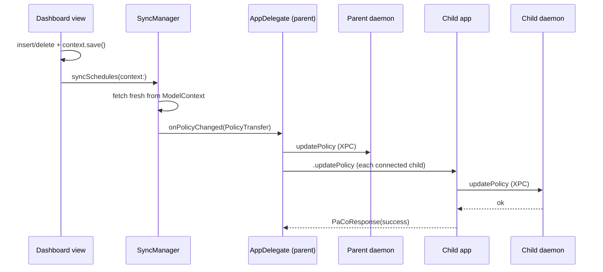
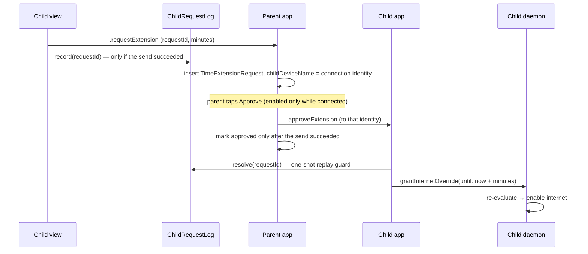
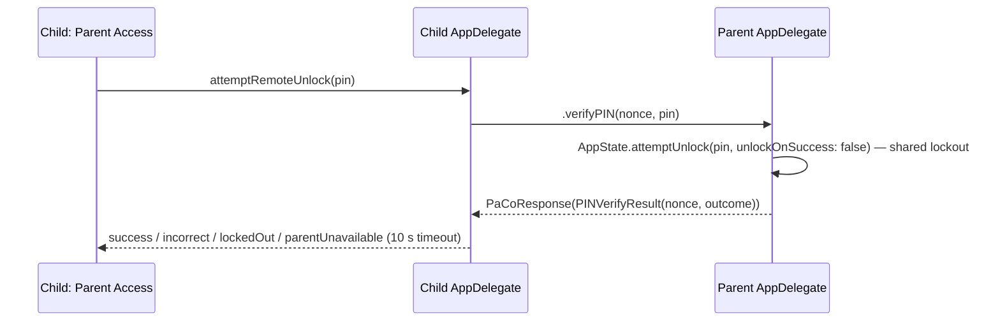

# Communication channels

PaCo uses four channels. A child's Mac uses Bonjour (3) or PaCo Cloud (4), never both.

## 1. App and agent to daemon: XPC

Mach service `com.paco.daemon`, interface `DaemonXPCProtocol` in PaCoShared. Every connection carries a code-signing requirement; see [Security model](security-model.md#xpc-peer-validation).

| Method | Caller | Purpose |
|---|---|---|
| `updatePolicy(_:reply:)` | App | Replace schedules and restrictions with a JSON `PolicyTransfer`. Persisted, then re-evaluated at once. |
| `setActiveProfile(_:reply:)` | App | Select which profile's rules apply on this Mac; `nil` means all. Sent at every launch and on change. |
| `grantInternetOverride(requestId:until:reply:)` | App (child) | Approved time extension. Clears a standing manual "off". |
| `setManualInternet(enabled:minutes:reply:)` | App (parent) | Timed manual toggle from Home. |
| `clearManualInternet(reply:)` | App (parent) | "Back to schedule". |
| `fetchPolicy(reply:)` | Agent, app | The current `DaemonPolicy` as JSON. |
| `isInternetEnabled(reply:)` | Agent, app | Whether the block is currently loaded. |
| `killProcess(pid:reply:)` | Agent | Kill a process if its signed bundle ID is in the restricted set. |
| `verifyFirewallIntegrity(reply:)`, `status(reply:)` | Diagnostics | Integrity check, human-readable status. |
| `cloud(_:reply:)` | App (child) | PaCo Cloud: a `CloudXPCRequest` (enroll, unenroll, status, submit or withdraw a request, verify the PIN), answered with a `CloudXPCResponse`. Both encoded with `CloudCodec`. |
| `reportUsage(_:reply:)` | Agent | Today's `UsageTransfer`, every 30 s. Uploaded to PaCo Cloud when enrolled, ignored otherwise. |

XPC replies arrive on an arbitrary queue. Both clients hop to the main queue before touching state.

## 2. Agent to app: per-user files

Directory: `~/Library/Application Support/com.paco/`. No policy lives here.

| File | Writer | Reader | Content |
|---|---|---|---|
| `usage.json` | Agent, every 30 s | App, via a `DispatchSource` watcher | `UsageTransfer` for today |
| `events.json` | Agent | Nobody yet | Last 100 `NotificationEvent`s: app blocked, internet on/off |
| `child-requests.json` | App (child) | App (child) | `ChildRequestStore`: sent requests and outcomes |
| `PaCo.store` | App | App | SwiftData database |

## 3. Parent app to child app: Bonjour + TLS-PSK

Service type `_paco._tcp` in `local.`. The child advertises, the parent connects. Details in [Parent–child networking](networking.md).

| Command | Direction | Payload | Reply |
|---|---|---|---|
| `.updatePolicy` | Parent → child | `PolicyTransfer` | `PaCoResponse` success/failure |
| `.requestExtension` | Child → parent | `ExtensionRequestPayload` | None; answered later |
| `.approveExtension` | Parent → child | `ExtensionResponsePayload` with `grantedMinutes` | None |
| `.denyExtension` | Parent → child | `ExtensionResponsePayload` | None |
| `.verifyPIN` | Child → parent | `PINVerifyRequest` with a nonce | `PaCoResponse` carrying `PINVerifyResult` |

## 4. Daemon to PaCo Cloud: HTTPS

On a cloud-managed child Mac, `CloudSyncService` in the daemon talks to the PaCo Cloud server: a long-poll on `/api/v1/device/events` brings commands from the parent, and heartbeats, usage, time requests and PIN checks go up. The device token lives in a root-only file; the app reaches the cloud only through the daemon's `cloud(_:reply:)`. Details in [PaCo Cloud server](cloud-server.md).

| Direction | What |
|---|---|
| Server → daemon (long-poll) | `policyChanged`, `activeProfileChanged`, `approveExtension`, `denyExtension`, `setManualInternet`, `clearManualInternet`, `unenrolled` |
| Daemon → server | Heartbeat every 30 s, usage snapshots, time requests, PIN checks, token rotation |

## Flows

### Policy change on the parent

A child that is offline gets the full policy in `onParentConnected` when it reconnects.

### Time extension

### Parent Access on a child

