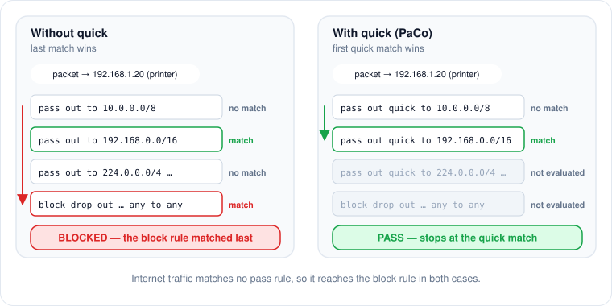

# Firewall (pf)

Internet blocking uses macOS's packet filter through a dedicated anchor, managed by `PaCoDaemon/FirewallManager.swift`, with rules built by `FirewallRuleBuilder` in PaCoShared.

## Rules

`FirewallRuleBuilder.blockInternetRules()` produces:

```
pass out quick to 10.0.0.0/8
pass out quick to 172.16.0.0/12
pass out quick to 192.168.0.0/16
pass out quick to 169.254.0.0/16
pass out quick to 127.0.0.0/8
pass out quick to 224.0.0.0/4
pass out quick to 255.255.255.255/32
pass out quick to ::1/128
pass out quick to fe80::/10
pass out quick to ff02::/16
block drop out proto { tcp udp icmp icmp6 } from any to any
```

The destinations come from `FirewallRuleBuilder.passDestinations`: private IPv4 ranges, link-local, loopback, multicast (Bonjour/mDNS), broadcast (DHCP), and their IPv6 equivalents. Keeping them reachable is what lets PaCo's own parent–child connection, printers and AirPlay work while the internet is off.


**pf evaluates every rule and the last match wins**, unless a rule is `quick`. Without `quick`, the final `block` would override every `pass`. Pass rules must stay `quick` and precede the block. `FirewallRuleTests` enforces this.


<figure><figcaption><p>Why every pass rule must be quick.</p></figcaption></figure>

## PaCo Cloud relay

On a Mac managed by PaCo Cloud, `blockInternetRules(relay:)` adds a table with the server's addresses and one pass rule for the server's port, both before the block:

```
table <paco_cloud> persist { 203.0.113.7 }
pass out quick proto tcp to <paco_cloud> port 443
```

Without it the child could not ask for more time, and the parent's commands could not arrive, while the internet is off. The daemon resolves the server's host while it can and calls `FirewallManager.updateRelay(_:)` when the addresses change. During a block it replaces only the table (`pfctl -a com.paco -t paco_cloud -T replace …`, or `-T flush` when empty), and reloads the anchor file only when the rules themselves change (enrolled, unenrolled, new port). It never re-runs `applyBlockLocked`, whose `pfctl -F states` would cut the open long-poll. Only literal IP addresses reach the rules (`CloudRelay.validAddresses`). See [PaCo Cloud server](cloud-server.md#staying-reachable-while-blocked).

## Applying and lifting the block

**Block** (`disableInternet` → `applyBlockLocked`):

1. Write the rules to `/etc/pf.anchors/com.paco`.
2. `pfctl -e` to enable pf. `runPfctl` treats any non-zero exit as a failure; see [Known limitations](known-limitations.md) for the open question about pf already being enabled.
3. Ensure `anchor "com.paco"` is referenced from `/etc/pf.conf`. The first time, PaCo backs up the file to `/etc/pf.conf.paco-backup`, appends the line and reloads; on failure it restores the backup.
4. `pfctl -a com.paco -f /etc/pf.anchors/com.paco` to load the anchor.
5. `pfctl -F states` so existing connections are cut, not only new ones.
6. Record `{"blocking": true}` in `/Library/Application Support/PaCo/daemon-state.json`.

**Allow** (`enableInternet`): flush the anchor's rules, delete the anchor file, record `{"blocking": false}`.

## Tamper recovery

The daemon runs `verifyIntegrity()` every 15 seconds. If it should be blocking and `pfctl -a com.paco -sr` no longer lists a `block drop` rule, it re-applies the block. The same timer re-bootstraps the agent into the console user's GUI domain in case it was unloaded.

## Locking

`FirewallManager` guards its state with a non-recursive `NSLock`.


Code that already holds the lock must call `applyBlockLocked()`, never `disableInternet()`. Calling the public method while holding the lock deadlocks the daemon. `verifyIntegrity()` is the one current example.


## Inspecting

```bash
sudo pfctl -a com.paco -sr          # rules currently loaded in the anchor
sudo pfctl -a com.paco -t paco_cloud -T show   # PaCo Cloud addresses (cloud-managed Macs)
sudo pfctl -s info | head -3        # is pf enabled?
cat /etc/pf.anchors/com.paco
grep paco /etc/pf.conf
cat "/Library/Application Support/PaCo/daemon-state.json"
```
