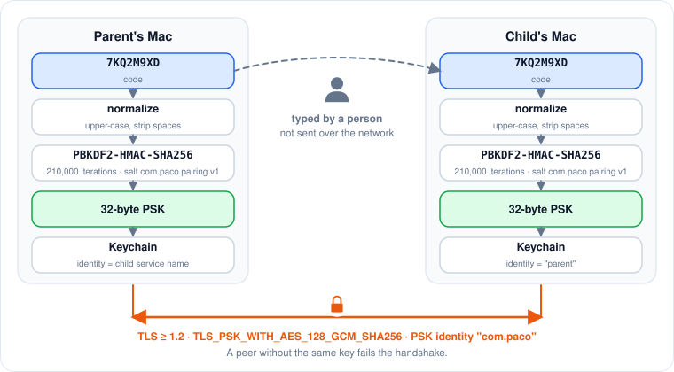
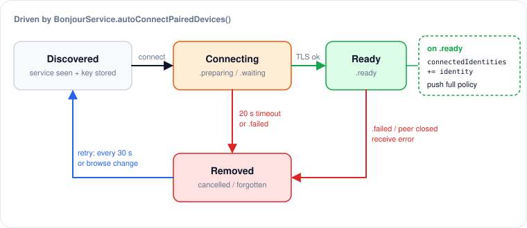
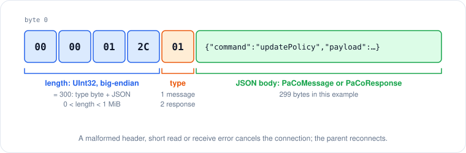

# Parent–child networking

All of this lives in `PaCo/Services/BonjourService.swift`, with wire types and key derivation in PaCoShared.

## Roles on the wire

| | Child | Parent |
|---|---|---|
| Bonjour | Advertises `_paco._tcp` with the computer name (`Host.current().localizedName`) | Browses `_paco._tcp` |
| Transport | `NWListener`: TLS-PSK if paired, plain TCP if not | One `NWConnection` per paired child (TLS client) |
| Peer identity | Stores its single parent key under `"parent"` | Stores one key per child under the child's **service name** |

## Pairing and keys

<figure><figcaption><p>Key derivation on both sides; the code never crosses the network.</p></figcaption></figure>

1. The parent generates an 8-character code from a 32-symbol alphabet (`0-9`, `A-Z` without `I L O U`), about 40 bits, from `SecRandomCopyBytes`.
2. Both sides derive a 32-byte key with PBKDF2-HMAC-SHA256, 210,000 iterations, fixed salt `com.paco.pairing.v1`. The code is upper-cased and stripped of spaces first.
3. Keys are stored in the Keychain (account `com.paco.pairing.keys`, a JSON list of identity/key pairs) by `PairingKeyManager`.
4. After pairing, the child restarts its listener so the TLS-PSK key takes effect.

The code never crosses the network. An eavesdropper who records a handshake would have to brute-force the code through PBKDF2.

## TLS parameters

* `sec_protocol_options_add_pre_shared_key` with identity `com.paco`.
* Minimum TLS 1.2, cipher suite `TLS_PSK_WITH_AES_128_GCM_SHA256` (`0x00A8`).
* `includePeerToPeer = true`.

A peer without the matching key fails the handshake.

### Unpaired children

An unpaired child advertises over **plain TCP** only so the parent can see its name under Nearby Devices, and **cancels every incoming connection**. There is no shared bootstrap key, so nothing on the LAN can talk to an unpaired child.

## Auto-connect (parent)

<figure><figcaption><p>Parent-side connection lifecycle.</p></figcaption></figure>

Connecting is app-level, independent of which dashboard tab is open:

* `autoConnectPairedDevices()` runs on every browse-results change and on a 30-second timer. It connects to every discovered service that has a stored key and no existing connection.
* A connection stuck in `.preparing` or `.waiting` is cancelled after 20 seconds so the next retry starts fresh.
* `.failed` or `.cancelled` removes the connection; the next retry reconnects.
* On `.ready`, the identity joins `connectedIdentities` and `onParentConnected` pushes the full policy.

`connectedIdentities` (parent) and `isParentConnected` (child) are the only "is the peer reachable" signals. An entry in `parentConnections` may still be handshaking.

## Framing

`FrameCodec` in `Network/MessageTypes.swift`:

<figure><figcaption><p>One frame on the wire.</p></figcaption></figure>

```
[ UInt32 big-endian body length ][ FrameType: 1 = message, 2 = response ][ JSON ]
```

* The body length includes the type byte, must be greater than 0 and below 1 MiB.
* Any malformed header, short read or receive error cancels the connection; the state handler cleans up and the retry path reconnects.
* `PaCoMessage` carries `command`, an optional JSON `payload` and a timestamp. `PaCoResponse` carries `success`, optional `payload` and `error`.

## Routing replies

Requests from a child are attributed to the **connection identity** they arrived on, never to the device name in the payload. Approvals and PIN results are sent back to that identity. Using a self-reported name breaks delivery whenever the paired name differs from the host name.

## Threading

Listener, browser and connections all run on the main queue, as do the callbacks into `AppDelegate`. `ChildRequestLog` relies on this.
