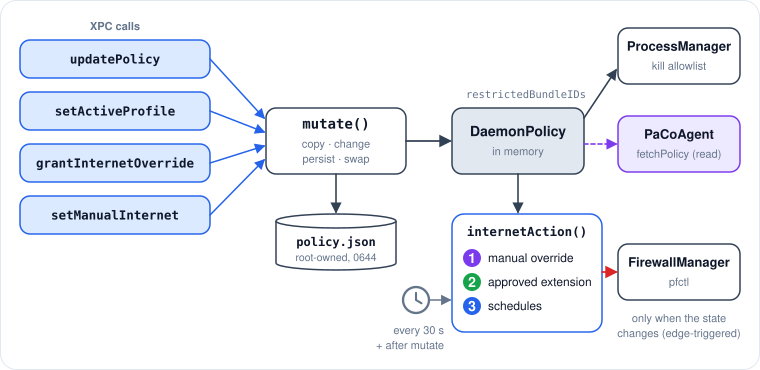
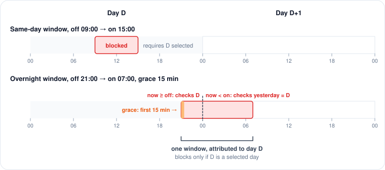

# Policy and enforcement

## DaemonPolicy

`DaemonPolicy` (PaCoShared, `Network/DaemonPolicy.swift`) is everything the daemon needs to decide:

| Field | Set by | Notes |
|---|---|---|
| `schedules: [ScheduleTransfer]` | `updatePolicy` | All schedules, including disabled ones. Each carries `profileId`. |
| `restrictions: [AppRestrictionTransfer]` | `updatePolicy` | Each carries `profileId`, `restrictionType`, `allowedScheduleId`. |
| `activeProfileId: UUID?` | `setActiveProfile` | Device-local. `apply(_:)` keeps it when new policy arrives. |
| `override: InternetOverride?` | `grantInternetOverride` | Approved extension: `requestId`, `grantedUntil`. |
| `manualOverride: ManualInternetOverride?` | `setManualInternet` | `enabled`, `until`. |
| `updatedAt: Date` | Every mutation | |

Derived values, all pure and unit-tested:

* `activeSchedules`, `activeRestrictions`: items of the active profile plus items without a profile; everything when no profile is active.
* `restrictedBundleIDs`: the kill allowlist pushed into `ProcessManager`.
* `internetAction(at:)`: the decision. See precedence below.
* `isScheduledAppAllowed(scheduleId:at:)`: the "Follows Schedule" rule.

## Precedence

```
manual override (if active)  →  .allowed / .blocked
approved extension (if active)  →  .allowed
ScheduleEvaluator over activeSchedules  →  .allowed / .blocked / .gracePeriod
```

Granting an extension clears a manual override whose `enabled` is `false`, so a parent's approval is not silently defeated by an earlier manual "off".

## PolicyEngine

`PaCoDaemon/PolicyEngine.swift` owns the policy inside the daemon.

<figure><figcaption><p>From XPC call to firewall.</p></figcaption></figure>

* **Load.** At init it reads `/Library/Application Support/PaCo/policy.json` (falls back to `.empty`) and seeds `ProcessManager` with `restrictedBundleIDs`.
* **Mutate.** Every XPC mutation goes through `mutate(_:)`: copy, change, stamp `updatedAt`, persist atomically with mode `0644`, swap in, update the kill allowlist, then schedule an immediate evaluation. If persisting fails the in-memory policy is unchanged and the XPC call replies with the error.
* **Evaluate.** A `DispatchSourceTimer` on a private queue fires 1 s after start and every 30 s. `.allowed` enables, `.blocked` disables, `.gracePeriod` leaves the current state alone and logs the remaining time.
* **Edge-triggered.** `lastAppliedEnabled` remembers the last state applied, so `pfctl` runs only on transitions. Because manual toggles are now part of the policy, each tick is a pure function of policy and clock.

The policy lock (`NSLock`) is never held while calling the firewall.

## ScheduleEvaluator

`PaCoShared/Schedule/ScheduleEvaluator.swift`, generic over `Schedulable` so it works for both the SwiftData `Schedule` and `ScheduleTransfer`.

`evaluate(schedules:at:overrideUntil:)`:

1. An `overrideUntil` in the future returns `.allowed`.
2. Inactive schedules are ignored. No active schedules returns `.allowed`.
3. Each schedule is evaluated alone. Any `.blocked` wins immediately; otherwise a `.gracePeriod` wins over `.allowed`.

<figure><figcaption><p>Day attribution for same-day and overnight windows.</p></figcaption></figure>

Per-schedule rules (`evaluateSingle`):

* `off == on` never blocks.
* **Same-day window** (`off < on`): blocked when `off ≤ now < on` and **today's** weekday is selected.
* **Overnight window** (`off > on`): blocked when `now ≥ off` and **today** is selected, or `now < on` and **yesterday** is selected. A window belongs to the day it starts on.
* **Grace period** applies only in the first `gracePeriodMinutes` after `off`, including when that wraps past midnight, and returns the remaining seconds.

Times use `Calendar.current`, so the child Mac's time zone and clock are authoritative.

## "Follows Schedule" app rules

`isScheduledAppAllowed(scheduleId:at:)`:

| Situation | Result |
|---|---|
| No `scheduleId`, or the id is not in `schedules` (deleted) | Blocked. The dashboard flags such a rule in red. |
| Schedule disabled | Allowed. A disabled schedule blocks nothing. |
| Otherwise | Allowed exactly when `ScheduleEvaluator` says `.allowed` for that one schedule, honouring an active extension. |

This is why `SyncManager.currentPolicy` ships inactive schedules too: the daemon must be able to resolve a disabled schedule to be lenient.

## Startup reconciliation

`FirewallManager.reconcileOnStartup()` re-applies the block if `daemon-state.json` says it was blocking, so a reboot or daemon crash never opens a window. `PolicyEngine.start()` then evaluates within a second.
