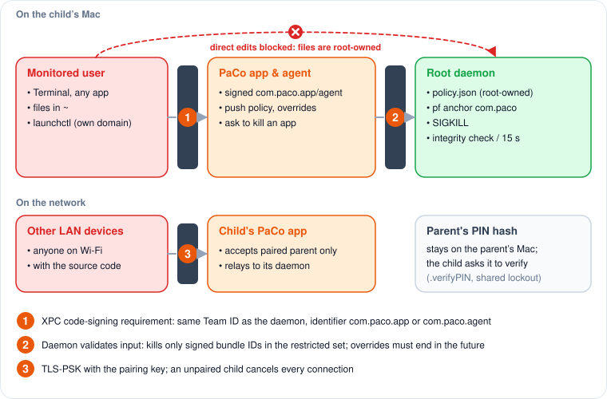

# Security model

## Assets and adversary

The adversary is the **monitored child**: logged in to a **standard** macOS account on their own Mac, curious, technically able, possibly with the source code. Assets to protect:

1. The enforcement decision (internet on/off, which apps run).
2. The parent PIN.
3. The parent–child channel, and on a cloud-managed Mac the device token.
4. The parent's PaCo Cloud account, which controls the child's Mac.

## Trust boundaries and mitigations

<figure><figcaption><p>Trust boundaries on the child’s Mac and on the network.</p></figcaption></figure>

| Threat | Mitigation | Where |
|---|---|---|
| Edit the schedule or forge an extension on disk | Policy lives only in the daemon, persisted root-owned under `/Library/Application Support/PaCo/`; the agent only reads it | `PolicyEngine` |
| Call the daemon from an arbitrary binary | Code-signing requirement on every XPC connection | `DaemonDelegate` |
| Make the daemon kill an arbitrary process | Kill only if the target's *signed* bundle ID is in the parent's restricted set | `ProcessManager` |
| Delete the pf anchor | Integrity check every 15 s re-applies the block | `FirewallManager.verifyIntegrity` |
| Unload the agent | Daemon re-bootstraps it every 15 s; launchd `KeepAlive` | `DaemonService.ensureAgentRunning` |
| Reboot to get an open window | Intended block state persisted and re-applied at daemon start | `reconcileOnStartup` |
| Open the parent dashboard on a shared Mac | PIN gate on every open; re-locks on popover close and app deactivation | `AppState.isUnlocked` |
| Brute-force the PIN through the UI | 5 attempts, then a 5-minute lockout, shared by local and remote checks | `PINManager` |
| Recover the PIN offline from the child's Mac | The PIN hash never leaves the parent; a child asks the parent to verify (`.verifyPIN`) | `AppDelegate.verifyPINWithParent` |
| Send commands to a child from the LAN | TLS-PSK with a pairing-derived key; an unpaired child drops every connection | `BonjourService` |
| Replay an approval | Each request id resolves once in the persisted `ChildRequestStore` | `ChildRequestLog` |
| Crash the app with a malformed payload | KDF rejects empty salt/password; frames are length-bounded; decode failures are ignored | `CryptoKDF`, `FrameCodec` |
| Read or replace the PaCo Cloud device token | Root-owned `cloud.json`, mode 0600, created with that mode before it holds the token | `CloudCredentials`, `SecureFile` |
| Recover the PIN of a cloud-managed Mac | The PIN hash lives only on the server (Argon2id); the Mac gets a verdict, with the same 5-try lockout | `PinVerifier` |
| Use the device token to change rules | The device API can read the policy and report; rules, approvals and the manual toggle exist only in the parent's web session | `routes/api.php` |
| Cut the Mac off from the cloud while blocked | Only the server's addresses and port pass the block; only literal IPs reach the rules | `CloudRelay` |
| Replay or delay a cloud command | Absolute end times; event ids at or below the cursor are skipped; a late grant is not applied | `CloudEventReducer` |
| Take over the parent's cloud account | Email verification, optional TOTP 2FA, password confirmation before removing a Mac or changing the PIN | `server/` |

## XPC peer validation

At startup the daemon reads its own Team Identifier from its code signature (`SecCodeCopySelf` → `kSecCodeInfoTeamIdentifier`) and builds:

```
anchor apple generic
and (identifier "com.paco.app" or identifier "com.paco.agent")
and certificate leaf[subject.OU] = "<daemon's team id>"
```

Each accepted `NSXPCConnection` gets this via `setCodeSigningRequirement(_:)`, so the system validates the peer on every message. There is no PID lookup and therefore no PID-reuse race, and there is no hard-coded team id to forget.

If the daemon itself has no team id (unsigned or ad-hoc build), it refuses every peer. A **Debug** daemon accepts unsigned peers only when launched with `PACO_ALLOW_UNSIGNED_XPC=1`; this branch is compiled out of Release.

## PIN storage

* PBKDF2-HMAC-SHA256, 210,000 iterations, 16-byte random salt, 32-byte output, constant-time comparison.
* Keychain generic passwords, service `com.paco.keychain`, accessible when unlocked, this device only.
* Attempt counter and lockout end are Keychain items too.

## PaCo Cloud

The device token is the cloud-managed Mac's only credential. A child who somehow read it could see their own policy, send bogus usage, send requests (rate limited and visible to the parent) and guess the PIN at the same 5-per-5-minutes rate as on the Mac itself. They could not change rules, approve anything or reach another device: all of that needs the parent's web session. Tokens are rotated every 30 days and die when the Mac is removed. TLS is mandatory in Release builds. See [PaCo Cloud server](cloud-server.md).

The server is trusted the way the parent's Mac is trusted on the LAN: whoever controls it controls the child's Mac.

## Out of scope

These are not defended against, by design or for now:

* **An administrator child.** An admin can `pfctl -d`, unload launchd jobs or delete files. Children must use standard accounts.
* **Physical access.** Recovery mode, target disk mode or reinstalling macOS bypass everything.
* **A LAN proxy.** Private ranges stay reachable, so a proxy on another device in the home network bypasses the block.
* **The parent's own account.** Anyone using it can delete the PIN items from the Keychain.
* **Clock changes.** Schedules use the system clock; a standard user cannot change it, an admin can.
