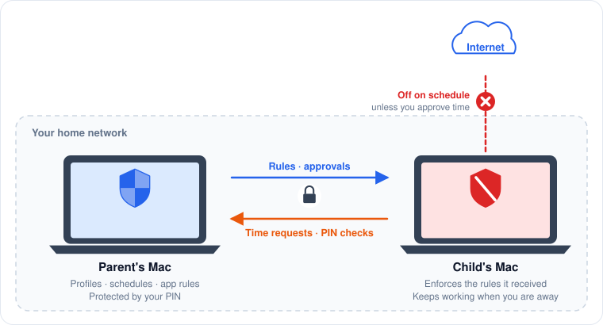
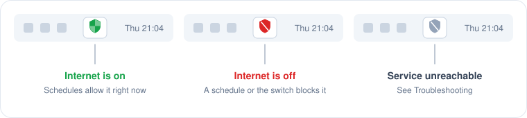

# User Guide

This guide is for parents. It walks through installing PaCo, pairing a child's Mac, and setting rules, then explains what the child sees.

## The two roles

Every Mac running PaCo has one role, chosen the first time PaCo opens.

| Role | Used on | What it does |
|---|---|---|
| **Parent** | Your Mac | Holds the profiles, schedules and app rules. Approves time requests. Protected by your PIN. |
| **Child** | Your child's Mac | Enforces the rules it receives from your Mac. Shows the child their status and lets them ask for more time. |

<figure><figcaption>
The two roles and what travels between them.
</figcaption></figure>

## Typical setup

1. [Install PaCo](installation.md) on both Macs.
2. On your Mac, choose **Parent** and create a PIN. On the child's Mac, choose **Child**. See [First launch](first-launch.md).
3. [Pair the two Macs](pairing.md) with a one-time code.
4. Create a [child profile](profiles.md), then add [internet schedules](schedules.md) and [app rules](app-rules.md).

From then on your Mac sends every change to the child's Mac automatically whenever both are on the same network.


**One Mac only?** You can set up a single Mac in the Parent role. Its rules then apply to that Mac, for every user account on it, including yours. See the [FAQ](faq.md#can-i-use-paco-on-a-single-shared-mac).


## The menu bar icon

PaCo lives in the menu bar, not in the Dock. Click the shield icon to open it.

<figure><figcaption>
The three states of the menu bar icon.
</figcaption></figure>

| Icon | Meaning |
|---|---|
| Green shield | Internet is on |
| Red shield with a slash | Internet is off |
| Grey shield with a slash | PaCo cannot reach its background service. See [Troubleshooting](troubleshooting.md#the-menu-bar-icon-is-grey). |
