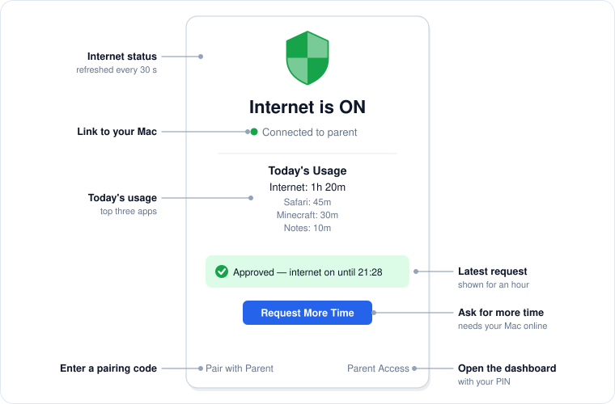
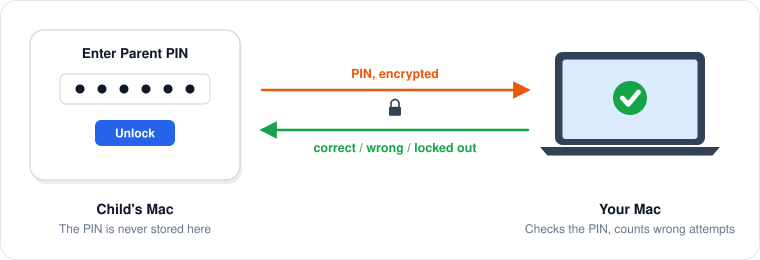

# On the child's Mac

Clicking the shield on the child's Mac opens the child view.

<figure><figcaption>
The child view and what each part does.
</figcaption></figure>

## The child view

| Element | Meaning |
|---|---|
| **Internet is ON / OFF** | The current state, refreshed every 30 seconds. |
| **Status line** | **Connected to parent**, **Paired — parent not connected**, or **Not paired with a parent**. |
| **Today's Usage** | Internet time today and the three apps used longest. |
| **Request card** | The latest time request and its outcome. Shown while waiting and for an hour after it was answered. |
| **Request More Time** | Ask the parent for more time. See [Requests](requests.md). |
| **Pair with Parent** | Enter a pairing code. See [Pairing](pairing.md). |
| **Parent Access** | Open the parent dashboard on this Mac with your PIN. |

There is no Quit button in the child view, so the child cannot close PaCo from the menu bar. Rules keep being enforced even if PaCo is closed, because the background services run on their own.

## Parent Access

**Parent Access** lets you open the dashboard on the child's Mac, for example to quit PaCo or to reset the Mac's role in **Settings**.

1. Click **Parent Access**.
2. Enter your PIN and click **Unlock**.

<figure><figcaption>
Parent Access asks your Mac to check the PIN.
</figcaption></figure>

The PIN is sent to your Mac over the encrypted connection and checked there; it is never stored on the child's Mac. This means:

* **Your Mac must be connected.** Otherwise the prompt says **Parent's Mac is not connected.**
* **Wrong PINs count on your Mac.** After 5 wrong PINs, PIN entry is locked for 5 minutes, both here and on your own dashboard.

When you close the dashboard, the child's Mac returns to the child view.


Profiles, schedules and app rules are managed on your Mac. The dashboard on a child's Mac does not list them.


## On a Mac managed by PaCo Cloud

The child view is the same, except that the link line shows the connection to PaCo Cloud, requests go to the parent's PaCo Cloud page, and Parent Access checks the PIN with PaCo Cloud. See [PaCo Cloud](cloud.md#on-the-childs-mac).
