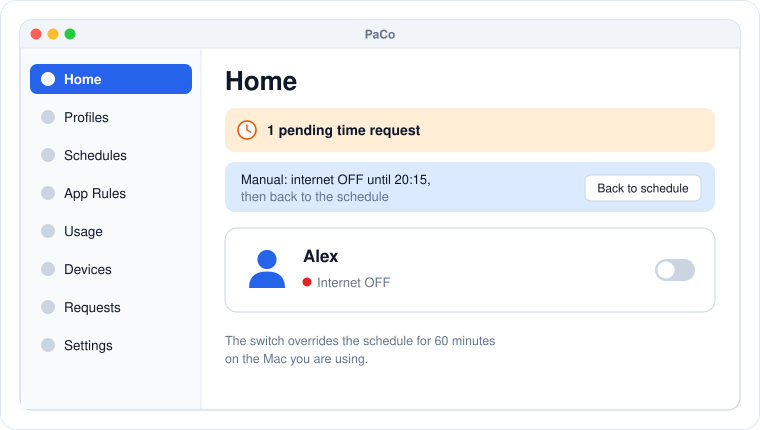

# First launch

Click the shield in the menu bar. The first time, PaCo shows **Welcome to PaCo** with two choices.

## On your Mac: Set up as Parent

1. Click **Set up as Parent**.
2. Enter a 6-digit PIN twice and click **Create**.
3. The parent dashboard opens.

<figure><figcaption>
The parent dashboard, open on Home.
</figcaption></figure>

The PIN protects every parent screen. You will be asked for it each time you open the dashboard. Choose a PIN your child does not know and cannot guess.

The dashboard has these sections in the sidebar:

| Section | What it is for |
|---|---|
| **Home** | Quick status, pending requests, and a manual internet switch. See [Home and manual control](home.md). |
| **Profiles** | One profile per child. See [Child profiles](profiles.md). |
| **Schedules** | When the internet is off. See [Internet schedules](schedules.md). |
| **App Rules** | Which apps are blocked. See [App rules](app-rules.md). |
| **Usage** | Daily internet and app time. See [Usage](usage.md). |
| **Devices** | Pair and see child Macs. See [Pairing](pairing.md). |
| **Requests** | Time extension requests from your child. See [Requests](requests.md). |
| **Settings** | Change the PIN or the Mac's role. See [PIN and settings](pin-and-settings.md). |

The **Quit PaCo** button is in the dashboard's toolbar.

## On the child's Mac: Set up as Child

Log in to the child's account and click **Set up as Child**. PaCo asks who manages this Mac:

* **A parent's Mac nearby.** PaCo switches to the child view. There is no PIN on the child's Mac; your PIN stays on your Mac and is checked there. Next, [pair the child's Mac](pairing.md) with yours.
* **PaCo Cloud, from a browser.** For a parent without a Mac of their own. Type the server address and the code from the PaCo Cloud page; see [PaCo Cloud](cloud.md).
