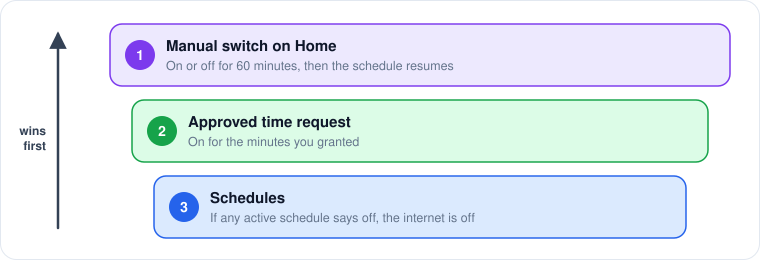

# Home and manual control

**Home** is the first page of the dashboard.

## What Home shows

* **Pending requests.** An orange banner shows how many time requests are waiting. Open **Requests** to answer them.
* **Manual override.** A blue banner appears while a manual switch is in effect, with the time it ends.
* **One card per profile**, with the internet status and a switch.

## The manual switch

<figure><figcaption>
The manual switch beats everything else while it lasts.
</figcaption></figure>

Flipping a profile card's switch turns the internet on or off **for 60 minutes**. After that, your schedules take over again. Click **Back to schedule** in the blue banner to end the override early.

The manual switch beats both schedules and approved requests while it lasts. Approving a time request ends a manual "off", so your approval is not silently cancelled.


The switch controls **the Mac you are using**, not a paired child's Mac. To give a child's Mac internet time from your Mac, approve a [time request](requests.md). Remote on/off is planned; see [Known limitations](../developer-guide/known-limitations.md).

