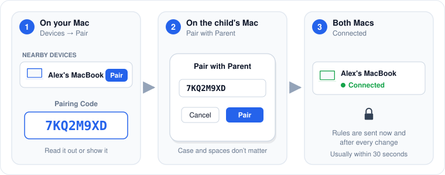

# Pairing a child's Mac

Pairing creates a secret key shared by the two Macs. Every message between them is encrypted with it, and a Mac without the key cannot connect at all.

## Before you start

* Both Macs are on the same network.
* PaCo is open on both Macs.
* The child's Mac is set up as **Child**.

## Pair

<figure><figcaption>
Pairing takes one code and about 30 seconds.
</figcaption></figure>

1. On your Mac, open the dashboard and click **Devices**.\
   The child's Mac appears under **Nearby Devices (Not Paired)** with its computer name.
2. Click **Pair** next to it. PaCo shows an 8-character **Pairing Code**.
3. On the child's Mac, click the shield in the menu bar, then **Pair with Parent**.
4. Type the code and click **Pair**. Upper or lower case does not matter, and spaces are ignored.
5. Within about 30 seconds, the child's Mac moves to **Paired Devices** on your Mac with the status **Connected**.

As soon as the Macs connect, your Mac sends its current schedules and app rules to the child's Mac. Every later change is sent immediately while connected, or the next time the child's Mac connects.

## Device status

| Status on your Mac | Meaning |
|---|---|
| **Connected** | The encrypted connection is up. Rules and replies are delivered. |
| **Online — connecting…** | The child's Mac is visible on the network and PaCo is connecting. Click **Retry** if it stays this way. |
| **Offline** | The child's Mac is not on the network, asleep, or PaCo is not running on it. |

On the child's Mac, the status line reads **Connected to parent**, **Paired — parent not connected**, or **Not paired with a parent**.

## Pairing by name

**Pair New Device** at the top of the Devices page lets you type a name instead of picking a nearby Mac. The name must match the child Mac's computer name exactly, as shown in **System Settings → General → About**. Picking the Mac from **Nearby Devices** avoids typos and is the recommended way.

## Renaming, unpairing and re-pairing

* **The child's Mac was renamed.** The pairing is tied to the computer name. Remove the old entry and pair again.
* **Unpair.** Click the trash icon next to the device in **Paired Devices**. Your Mac forgets the key and stops connecting. The child's Mac keeps enforcing the last rules it received.
* **Pair the child's Mac with a different parent Mac.** Enter the new parent's code under **Pair with Parent**. A child's Mac has one parent at a time; the new code replaces the old one.


An unpaired child's Mac is visible on the network so you can find it, but it refuses every connection. Nobody on your network can send it commands until it is paired.

