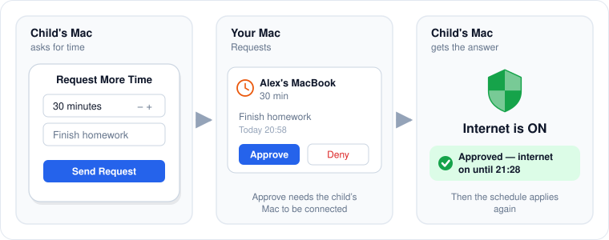

# Time extension requests

When the internet is off, your child can ask for more time. You decide on your Mac, and an approval turns the internet on immediately on their Mac for the minutes they asked for.

<figure><figcaption>
A request from start to finish.
</figcaption></figure>

## What the child does

1. Click the shield in the menu bar and then **Request More Time**.\
   The button is available only while the child's Mac is connected to your Mac.
2. Choose 15 to 120 minutes, optionally type a reason, and click **Send Request**.
3. A card shows **Request for N min sent at HH:MM — waiting for parent…**

The child can have one request waiting at a time. **Withdraw** on the card cancels it. A request nobody answered is dropped after 24 hours.

## What you do

1. The Home page shows an orange banner, and the request appears in **Requests** under **Pending**, with the child's Mac name, the minutes and the reason.
2. Click **Approve** or **Deny**.

| Your answer | On the child's Mac |
|---|---|
| **Approve** | The internet turns on at once for the requested minutes. The card shows **Approved — internet on until HH:MM**. After that, the schedule applies again. |
| **Deny** | The card shows **Request denied**. Nothing else changes. |

Answered requests move to **Resolved** with their outcome. The last 20 are kept.

## When the child's Mac is offline

**Approve** is disabled while the child's Mac is not connected, and the request shows **Child is offline — approval will be possible when it reconnects.** The request stays pending, so you can approve it once the Macs reconnect.

**Deny** always works. If the child's Mac is offline, it does not hear about the denial; its request stays "waiting" until withdrawn or dropped after 24 hours.

## Things to know

* An approval applies to that one request. Approving the same request twice has no effect.
* Approvals still arrive after the child's Mac restarts PaCo, because the child's Mac remembers its outstanding request.
* An approval ends a manual "off" set on the child's Mac.
