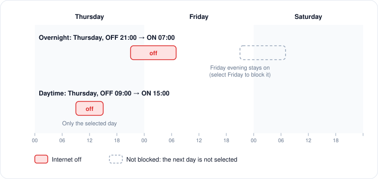

# Internet schedules

A schedule turns the internet off between two times on the days you choose. While the internet is off, websites, games and apps cannot reach the internet. Devices on your home network, such as printers and AirPlay speakers, stay reachable.

## Add a schedule

1. Open **Schedules** and click **Add Schedule**. You need at least one [profile](profiles.md) first.
2. Fill in the form. The fields are described below.
3. Click **Create**. The schedule takes effect right away and is sent to the child's Mac.

| Field | Meaning |
|---|---|
| **Label** | A name you will recognise, for example "School nights". |
| **Profile** | The child this schedule is for. |
| **Days** | The days the off period *starts* on. |
| **Internet OFF at** | When the internet goes off. Minutes are in 15-minute steps. |
| **Internet ON at** | When the internet comes back. |
| **Grace period** | 0–15 minutes during which the internet stays on after the off time. The default is 5. |

## How days and times work

**Overnight periods belong to the day they start on.** If the off time is later than the on time, the period runs past midnight.

<figure><figcaption>
Overnight periods run into the next morning; daytime periods stay on their day.
</figcaption></figure>

* *Thursday, off 21:00, on 07:00* turns the internet off on Thursday at 21:00 and back on at Friday 07:00.
* It does not turn the internet off on Friday evening unless Friday is also selected.
* To cover every school night, select Sunday to Thursday.

**Daytime periods use the selected day only.** *Monday, off 09:00, on 15:00* blocks Monday from 09:00 to 15:00.

**Equal times mean no block.** A schedule whose off and on times are the same does nothing.

## Several schedules

When more than one schedule applies at the same moment, the strictest wins: if any of them says the internet should be off, it is off.

## Turn a schedule off or remove it

* Use the switch on the right of a schedule to disable it without deleting it. A disabled schedule shows **Disabled** and blocks nothing.
* To delete a schedule, use the list's delete gesture on its row (swipe left on a trackpad).

## What can override a schedule

<figure><figcaption>
What decides whether the internet is on, in order.
</figcaption></figure>

In order of priority:

1. **The manual switch** on the Home page, for 60 minutes. See [Home and manual control](home.md).
2. **An approved time request**, for the minutes you granted. See [Requests](requests.md).
3. **Your schedules.**
