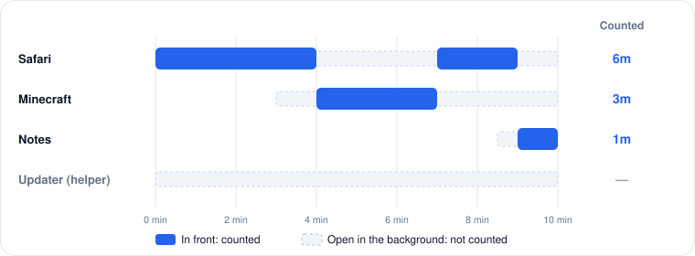

# Usage

PaCo keeps a daily record of:

* **Internet time**: how long the internet was on.
* **App time**: how long each app was in the foreground, and how many times it was opened.

## Where to see it

* **On your Mac**, the **Usage** page lists one entry per day for the Mac you are using.
* **On the child's Mac**, the child view shows today's internet time and the top three apps.


In this version, a child Mac's usage is shown on the child's Mac only. It is not sent to your dashboard yet.


## How time is counted

<figure><figcaption>
Only the app in front accrues time.
</figcaption></figure>

* Only the app in front counts. An app open in the background does not add time.
* An app's time counts while it is still open, not only after it quits.
* Only regular apps with a Dock icon are counted, not background helpers.
* The counters start over at midnight.
* The numbers update about every 30 seconds.
